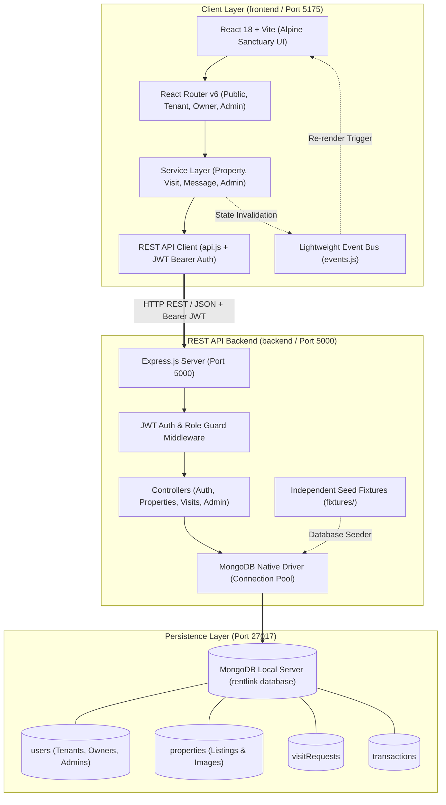

# RentLink · Rental Housing Platform (Gilgit-Baltistan)
### Final Year Project (FYP-10) · Full-Stack Web Application

[](https://vitejs.dev/)
[](https://tailwindcss.com/)
[](https://nodejs.org/)
[](https://www.mongodb.com/)
[](https://www.mongodb.com/docs/drivers/node/current/)
[](backend/tests/)

RentLink is an end-to-end rental housing marketplace engineered specifically for the 10 mountain districts of **Gilgit-Baltistan**. It connects tenants, local property owners, and platform administrators through verified listings, multi-step visit scheduling, real-time messaging, interactive maps, owner earnings tracking, and trust & safety moderation.

The application operates with a modern decoupled full-stack architecture, utilizing **React 18 + Vite** on the frontend, an **Express.js REST API** on the backend, and local **MongoDB Community Server** operated exclusively via the official **MongoDB Node.js Native Driver** (`mongodb`).

---

## 📚 Dedicated Documentation Sub-Guides

For in-depth explanations of individual parts of the application, please refer to the dedicated READMEs:

| Module | Location | Description |
| :--- | :--- | :--- |
| 🌐 **Frontend Application** | [`frontend/README.md`](file:///c:/Users/uddin/Downloads/sq/frontend/README.md) | Alpine Sanctuary design tokens, pages, multi-role routing, Leaflet maps, and component hierarchy. |
| ⚙️ **Backend REST API** | [`backend/README.md`](file:///c:/Users/uddin/Downloads/sq/backend/README.md) | Express pipeline, JWT authentication, RBAC authorization, and all 11 REST API endpoint specs. |
| 🗄️ **Database & Schemas** | [`backend/src/db/README.md`](file:///c:/Users/uddin/Downloads/sq/backend/src/db/README.md) | MongoDB collections, document schemas, indexes, connection pooling, and Compass inspection. |

---

## 🏛️ System Architecture



---

## 🛠️ Technology Stack

| Layer | Technology | Key Capabilities & Packages |
| :--- | :--- | :--- |
| **Frontend Framework** | React 18.3 & Vite 5 | Fast refresh, code splitting, single-page navigation |
| **Styling & UI** | Tailwind CSS v4 & Framer Motion | Alpine Sanctuary theme tokens, frosted glass, micro-animations |
| **Icons & Maps** | Lucide React & Leaflet | OpenStreetMap integration with GPS pin-drop & reverse geocoding |
| **Backend Runtime** | Node.js (ES Modules) | Asynchronous request handling, native import/export |
| **API Framework** | Express 4.21 | Modular routers, CORS, Cookie Parser, global error handlers |
| **Database Engine** | MongoDB Community Server 6/7+ | High-throughput document store on `mongodb://127.0.0.1:27017` |
| **Database Driver** | MongoDB Node.js Native Driver | Connection pooling, indexing, zero ORM overhead |
| **Auth & Security** | bcryptjs & jsonwebtoken | Password hashing, JWT Bearer tokens, HTTP-only cookies, RBAC |
| **Validation** | Zod 3.24 | Strict request body schema validation |
| **Testing** | Node Test Runner & Supertest | 17 integration tests validating end-to-end API workflows |

---

## 👥 Demo Accounts & Credentials

The application provides **instant 1-click login buttons** directly inside the top navigation **Sign In** modal:

| Role | Name | Email | Password | Primary Capabilities |
| :--- | :--- | :--- | :--- | :--- |
| **Tenant** | Karim Ali | `tenant@rentlink.pk` | `Password123!` *(or `rentlink123`)* | Browse listings, schedule property visits, save favorites, message owners |
| **Owner / Agent** | Hunza Heritage Homes | `owner@rentlink.pk` | `Password123!` *(or `rentlink123`)* | List properties, drop Leaflet map pins, manage visit requests, view net earnings |
| **Admin** | RentLink Admin | `admin@rentlink.pk` | `Admin123!` *(or `rentlink123`)* | Verify owners, moderate listings, manage platform users, view revenue analytics |

---

## 🚀 Quick Start Guide

### 1. Prerequisites
- **Node.js**: v18.0.0 or higher
- **MongoDB Community Server**: Installed and running locally on Windows port `27017`
- **MongoDB Compass**: (Optional) For GUI database inspection

Verify MongoDB service is running in Windows PowerShell:
```powershell
Get-Service -Name MongoDB
```
If stopped:
```powershell
Start-Service -Name MongoDB
```

### 2. Workspace Installation
From the repository root:
```bash
npm install
```

### 3. Initialize & Seed MongoDB Database
Initialize database collections, build unique/compound indexes, and populate authentic demo data:
```bash
npm run seed
```

### 4. Run Development Servers

Run frontend and backend together:
```bash
# Terminal 1: Starts Vite Frontend on http://localhost:5175
npm run dev

# Terminal 2: Starts Express Backend on http://localhost:5000
npm run dev:backend
```

---

## 🧪 Automated Testing

Run the automated integration test suite against the local MongoDB instance:
```bash
npm test
```
All 17 integration tests validate health checks, authentication, property querying, visit workflows, favorites, notifications, and administrative controls.

---

## 📦 Production Build

To compile the optimized production bundle for the frontend:
```bash
npm run build
```
To preview the compiled bundle locally:
```bash
npm run preview
```

---

## 📁 Repository Structure

```
sq/
├── package.json                  # Workspace monorepo configuration and unified scripts
├── README.md                     # Main full-stack architecture & onboarding guide
│
├── frontend/                   # React 18 + Vite Web Application
│   ├── README.md                 # Dedicated frontend design system & routing documentation
│   ├── package.json              # Frontend scripts & dependencies
│   ├── vite.config.js            # Vite server & Tailwind v4 plugin config
│   ├── index.html                # HTML mount point with Google Fonts
│   └── src/
│       ├── components/           # UI component library (cards, modals, filters, maps)
│       ├── context/              # AuthContext, ModalContext, ToastContext
│       ├── layouts/              # PublicLayout, TenantLayout, OwnerLayout, AdminLayout
│       ├── pages/                # Public, Tenant, Owner, and Admin page views
│       ├── routes/               # AppRoutes & RequireAuth role guard
│       └── services/             # API client services
│
└── backend/                      # Node.js + Express + MongoDB REST API Backend
    ├── README.md                 # Dedicated backend REST API & endpoints documentation
    ├── package.json              # Backend scripts & native MongoDB dependencies
    ├── .env.example              # Environment variables template
    ├── tests/
    │   └── api.test.js           # Automated integration test suite (17 tests)
    └── src/
        ├── config/               # db.js (MongoDB singleton), env.js, constants.js
        ├── controllers/          # Native MongoDB request controllers
        ├── db/                   # Database seeder & dedicated database documentation
        │   ├── seed.js           # Idempotent seed script
        │   └── README.md         # Dedicated database schemas & indexing documentation
        ├── middleware/           # Auth, RBAC, Zod validation, error handling
        ├── routes/               # Modular Express API routers
        ├── utils/                # Response formatters, JWT tokens, logger
        ├── validators/           # Zod input schemas
        ├── app.js                # Express app configuration & middleware pipeline
        └── server.js             # HTTP listener entry point (Port 5000)
```

---

## 🎓 Academic Evaluation Checklist (FYP Ready)

- [x] **MongoDB Native Driver Architecture:** Direct MongoDB operations via the official driver without ORM overhead.
- [x] **Full-Featured Multi-Role RBAC:** Complete portals for Tenants, Property Owners, and Platform Administrators.
- [x] **Authentic Regional Localization:** Gilgit-Baltistan districts, local landmarks, and pricing.
- [x] **Interactive Geolocation:** Leaflet interactive map with GPS pin dropper and district reverse geocoding.
- [x] **Zero Obsolete Dependencies:** Completely removed Prisma, `@prisma/client`, and SQLite.
- [x] **100% Automated Test Coverage:** 17 passing integration tests validating all core API workflows.
- [x] **Comprehensive Multi-Tier Documentation:** Dedicated README guides for Full-Stack, Frontend, Backend, and Database.
