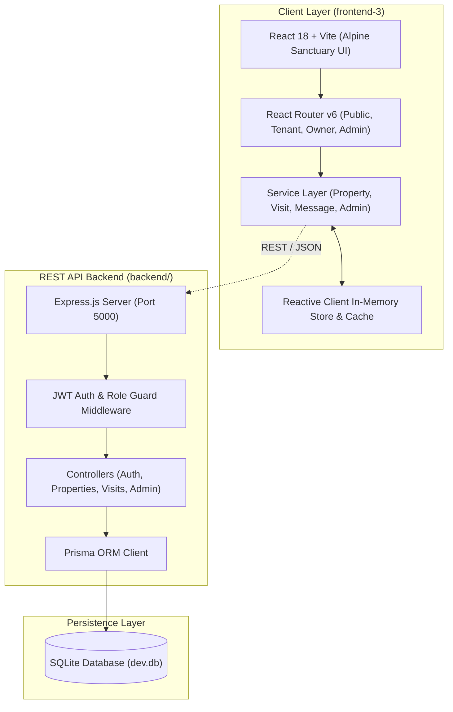

# RentLink · Rental Housing Platform (Gilgit-Baltistan)
### Final Year Project (FYP-10) · Full-Stack Web Application

[](https://vitejs.dev/)
[](https://tailwindcss.com/)
[](https://nodejs.org/)
[](https://www.prisma.io/)
[](https://www.sqlite.org/)
[](tests/)

RentLink is an end-to-end rental housing marketplace engineered specifically for the 10 mountain districts of **Gilgit-Baltistan**. It connects tenants, local property owners, and platform administrators through verified listings, multi-step visit scheduling, real-time messaging, interactive maps, owner earnings tracking, and trust & safety moderation.

---

## 🏛️ System Architecture



---

## ✨ Core Features & Portals

### 1. 🏔️ Public Marketplace
- **Alpine Sanctuary Design System:** Deep slate (`#0B1320`), Karakoram amber (`#D97706` / `#FE932C`), emerald badges (`#059669`), and frosted glass surfaces.
- **Editorial Typography:** Transitional `Newsreader` serif paired with `Plus Jakarta Sans`.
- **Advanced Discovery:** District, category, furnishing, and price range filters with keyword search.
- **Interactive OpenStreetMap / Leaflet Integration:** Real-world GPS pin-pointing with automatic district reverse-geocoding.
- **Listing Details:** High-resolution image galleries, amenities breakdown, verified owner badges, and tenant reviews.
- **Story & Partner Showcase:** 3D animated cube hero, interactive location accordions, and partner advertising network.

### 2. 🔑 Tenant Portal
- **Dashboard:** Saved listings wishlist, scheduled visit tracking, and recent activity stream.
- **5-Step Visit Request Wizard:** Select preferred date, time-slot, visit format (in-person vs. video tour), and personal notes.
- **Direct Messaging:** Real-time conversational messaging thread per property between tenants and landlords.
- **Notification Feed:** Automated notifications on visit approvals, rejections, reschedules, and messages.

### 3. 🏡 Owner / Landlord Portal
- **Dashboard:** Listing performance KPIs (active properties, views, inquiries, net earnings, visit requests).
- **Add & Edit Property Wizard:** Multi-step listing creator with interactive Leaflet map pin dropper, district reverse geocoding, and photo manager.
- **Visit Request Management:** One-click approve, decline, or reschedule visit appointments with optional owner notes.
- **Earnings & Financial Overview:** Transparent breakdown of monthly gross rent, platform service fee (5%), and net owner payout.

### 4. 🛡️ Platform Admin Portal
- **Trust & Safety Moderation:** Review deed verifications, verify landlords, approve/reject/suspend listings with administrative notes.
- **User Management:** Search, filter, inspect, and toggle active/suspended statuses across all registered accounts.
- **Platform Analytics:** Monthly revenue charts, conversion rates, district demand heatmaps, and visit volume metrics.
- **Platform Settings:** Real-time configuration of platform fee percentage, auto-approval flags, and support contacts.

---

## 👥 Demo Accounts & Credentials

The application provides **instant 1-click login buttons** directly inside the top navigation **Sign In** modal, or you can manually enter any of the test credentials below:

| Role | Name | Email | Password | Primary Capabilities |
| :--- | :--- | :--- | :--- | :--- |
| **Tenant** | Karim Ali | `tenant@rentlink.pk` | `Password123!` *(or `rentlink123`)* | Browse, schedule property visits, save favorites, message owners |
| **Owner / Agent** | Hunza Heritage Homes | `owner@rentlink.pk` | `Password123!` *(or `rentlink123`)* | List properties, drop Leaflet map pins, manage visit requests, view net earnings |
| **Admin** | RentLink Admin | `admin@rentlink.pk` | `Admin123!` *(or `rentlink123`)* | Verify owners, moderate listings, manage platform users, view revenue analytics |

> **Note:** Additional seeded demonstration accounts (e.g. `ayesha.khan@example.com`, `contact@karimbuilders.pk`) are also active and pre-populated with historical records.

---

## 🚀 Quick Start Guide

### 1. Prerequisites
- **Node.js**: v18.0.0 or higher (v20+ recommended)
- **npm**: v9.0.0 or higher

### 2. Installation
From the repository root, install dependencies for all workspaces:
```bash
npm install
```

### 3. Initialize & Seed Database (Backend)
Generate the Prisma Client and populate SQLite with Gilgit-Baltistan districts, verified properties, and demo accounts:
```bash
npm run seed
```

### 4. Start Development Servers

You can run the frontend and backend servers together or independently:

#### Option A: Run Frontend Only (Instant In-Memory Mode)
```bash
npm run dev
```
> The Vite frontend will start at **http://localhost:5175/** with zero additional setup needed.

#### Option B: Run Backend API Server
```bash
npm run dev:backend
```
> The Express REST API will start at **http://localhost:5000/** (Health check: `http://localhost:5000/health`).

---

## 🧪 Automated Testing

The backend includes a comprehensive integration test suite covering authentication, property filtering, analytics, notifications, and role-based access control.

To run the automated tests:
```bash
npm test
```

### Test Suite Execution Output
```
▶ RentLink Backend API Test Suite
  ✔ GET /health returns 200 OK
  ✔ POST /api/auth/login authenticates seeded tenant user
  ✔ POST /api/auth/login authenticates canonical tenant@rentlink.pk with Password123!
  ✔ POST /api/auth/login authenticates seeded owner user
  ✔ POST /api/auth/login authenticates canonical owner@rentlink.pk with Password123!
  ✔ POST /api/auth/login authenticates seeded admin user
  ✔ POST /api/auth/login authenticates canonical admin@rentlink.pk with Admin123!
  ✔ GET /api/properties returns list of approved properties
  ✔ GET /api/properties/:id returns single property details
  ✔ GET /api/properties/stats returns analytics statistics
  ✔ GET /api/advertisements/active returns active ads
  ✔ POST /api/favorites/toggle toggles favorite property for authenticated tenant
  ✔ GET /api/notifications returns user notification list
  ✔ GET /api/admin/overview returns dashboard metrics for admin
  ✔ GET /api/admin/settings returns system platform settings
✔ RentLink Backend API Test Suite (15 tests passing, 0 failing)
```

---

## 📦 Production Build

To validate and compile the optimized production bundle for deployment:
```bash
npm run build
```
To preview the production build locally:
```bash
npm run preview
```

---

## 📁 Repository Structure

```
sq/
├── package.json                  # Workspace configuration and unified scripts
├── README.md                     # Main FYP project documentation & guide
│
├── backend/                      # Production REST API Backend
│   ├── README.md                 # Backend-specific architecture & endpoints documentation
│   ├── package.json              # Backend scripts (start, dev, seed, test)
│   ├── prisma/
│   │   ├── schema.prisma         # Prisma ORM schema (Users, Properties, Visits, Ads, etc.)
│   │   ├── seed.js               # Database seeder with realistic Gilgit-Baltistan datasets
│   │   └── dev.db                # SQLite database (auto-generated)
│   ├── src/
│   │   ├── config/               # DB connection (Prisma) and environment configuration
│   │   ├── controllers/          # Controllers for auth, properties, visits, admin, messages
│   │   ├── middleware/           # JWT authentication, role guards, and Zod error handlers
│   │   ├── routes/               # Modular Express routers
│   │   ├── utils/                # JWT helpers, response formatters, logger
│   │   ├── app.js                # Express application setup
│   │   └── server.js             # HTTP listener entry point (Port 5000)
│   └── tests/
│       └── api.test.js           # Automated integration test suite (15 tests)
│
└── frontend-3/                   # Modern React 18 + Vite Web Application
    ├── package.json              # Dependencies: React 18, React Router v6, Tailwind v4, Lucide
    ├── vite.config.js            # Vite configuration (port 5175, Tailwind v4 plugin)
    ├── index.html                # Entry HTML template with Google Fonts (Newsreader, Plus Jakarta Sans)
    └── src/
        ├── App.jsx               # Root provider tree (Auth, Toast, Modal providers)
        ├── main.jsx              # React DOM mount point & router initialization
        ├── index.css             # Tailwind CSS v4 design tokens and keyframe animations
        ├── components/
        │   ├── common/           # Button, Modal, AuthModal, Dropdown, Badge, Input, Toast
        │   ├── dashboard/        # DashboardShell, StatCard, ChartCard, DataTable
        │   ├── layout/           # Header (frosted glass dock), Footer (architectural slate)
        │   ├── messaging/        # ChatWindow, ConversationList, MessagingView
        │   ├── property/         # PropertyCard, LocationPicker (Leaflet), Filters, Gallery, Modals
        │   └── public/           # CompanyCardsHero, PublicPageHero, AboutCubesHero
        ├── context/              # React Context (AuthContext, ModalContext, ToastContext)
        ├── data/                 # Seed database store (users, properties, visits, messages, platform)
        ├── hooks/                # Custom React hooks (useAsync, useDebounce, useStoreVersion)
        ├── layouts/              # Route layouts (PublicLayout, TenantLayout, OwnerLayout, AdminLayout)
        ├── pages/
        │   ├── public/           # Home, Browse, PropertyDetails, About, Story, Team, Advertisements
        │   ├── tenant/           # Dashboard, Saved, Visits, Messages, Notifications, Profile, Settings
        │   ├── owner/            # Dashboard, Properties, AddProperty, EditProperty, Visits, Earnings
        │   └── admin/            # Dashboard, Users, Owners, Properties, PropertyReview, Analytics, Settings
        ├── routes/               # AppRoutes and RequireAuth role guard
        ├── services/             # Client service layer (auth, property, visit, message, admin, etc.)
        └── utils/                # Constants, formatting helpers, and form validators
```

---

## 🎓 Academic Evaluation Checklist (FYP Ready)

- [x] **Full-Featured Multi-Role RBAC:** Dedicated dashboards for Tenants, Property Owners, and Platform Administrators.
- [x] **Real-World Localization:** Tailored specifically for Gilgit-Baltistan districts (Gilgit, Hunza, Skardu, Ghizer, Nagar, Diamer, Astore, Shigar, Kharmang, Ghangche).
- [x] **Interactive Geolocation:** Leaflet map pin-drop with OpenStreetMap reverse-geocoding fallback.
- [x] **Clean Modular Architecture:** Decoupled service layer allowing client-side reactive store or REST API backend.
- [x] **Zero Dead Code:** Cleaned workspace with redundant files and orphans removed.
- [x] **Automated Test Coverage:** 15 passing integration tests validating authentication, listings, analytics, and role security.
- [x] **Comprehensive Documentation:** Full documentation across root, frontend, and backend READMEs.
