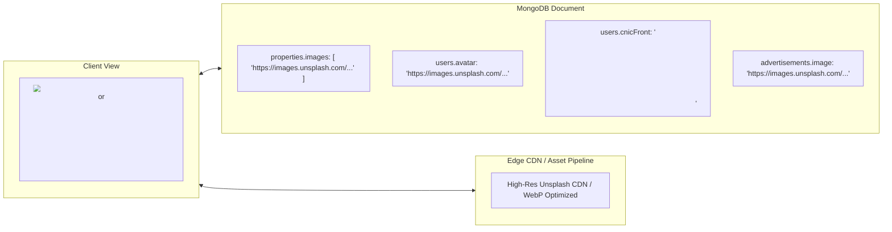

# RentLink Database Architecture & Guide (MongoDB)

This document provides a comprehensive guide to the **RentLink** database layer. The project uses **MongoDB Community Server** locally on Windows, powered exclusively by the official **MongoDB Node.js Native Driver** (`mongodb`) without any ORM, ODM, or Mongoose layer.

---

## 📋 Table of Contents
1. [Overview & Design Principles](#1-overview--design-principles)
2. [Connection & Configuration](#2-connection--configuration)
3. [Collections & Schema Specification](#3-collections--schema-specification)
4. [Image & Media Storage Strategy](#4-image--media-storage-strategy)
5. [Indexing Strategy & Constraints](#5-indexing-strategy--constraints)
6. [Database Seeding & Initialization](#6-database-seeding--initialization)
7. [Inspecting with MongoDB Compass](#7-inspecting-with-mongodb-compass)
8. [Query Patterns & ID Normalization](#8-query-patterns--id-normalization)
9. [Troubleshooting](#9-troubleshooting)

---

## 1. Overview & Design Principles

- **Database Engine:** MongoDB Community Server (v6.0 or v7.0+)
- **Driver:** Official Node.js Native Driver (`mongodb` v7.7+)
- **No ORM / No ODM:** Direct collection operations (`find`, `findOne`, `insertOne`, `insertMany`, `updateOne`, `deleteMany`, `countDocuments`, `aggregate`).
- **Connection Singleton:** A shared `MongoClient` connection pool is initialized once during server boot and reused across all incoming requests.
- **Embedded vs. Referenced Data:**
  - High-cardinality entities (Users, Properties, Visits, Transactions) use dedicated collections with string/ObjectId references.
  - Low-cardinality, tightly-bound attributes (Property images, Property amenities) are embedded directly inside the document.
- **Backward Compatibility:** All document responses format `_id` into a string `id` field to maintain 100% compatibility with existing REST endpoints and frontend state.

---

## 2. Connection & Configuration

### Connection Module
Location: [`backend/src/config/db.js`](file:///c:/Users/uddin/Downloads/sq/backend/src/config/db.js)

### Connection Settings
The database connection is configured via environment variables:
```env
MONGODB_URI="mongodb://127.0.0.1:27017"
MONGODB_DB_NAME="rentlink"
```

### Connection Pool Configuration
```javascript
client = new MongoClient(uri, {
  maxPoolSize: 50,              // Up to 50 concurrent socket connections
  minPoolSize: 5,               // 5 warm idle connections
  serverSelectionTimeoutMS: 5000,
});
```

### Graceful Termination
The connection is closed cleanly upon receiving `SIGINT` (Ctrl+C) or `SIGTERM` signals:
```javascript
process.on('SIGINT', () => shutdown('SIGINT'));
process.on('SIGTERM', () => shutdown('SIGTERM'));
```

---

## 3. Collections & Schema Specification

The `rentlink` database contains **12 collections**:

### 1. `users`
Stores user identity, roles, profile metadata, credentials, and verification states across all three platform personas: **Tenants**, **Property Owners / Agents**, and **Platform Administrators**.

#### Role-Based Data Architecture & Password Security:
* **Password Encryption:** Passwords are never stored in plaintext. They are salted and encrypted using `bcryptjs` with salt rounds 10 (`passwordHash: "$2a$10$..."`). During authentication, `bcrypt.compare()` validates the password, and `passwordHash` is always stripped before documents are returned to the client.
* **Tenant Documents:** Contain tenant identity, verified phone, residency tags (`district`, `city`, `area`), bio, and verification level (`unverified | pending | verified`).
* **Owner Documents:** Contain property operator credentials extended with official NADRA CNIC verification fields (`cnic`, `cnicName`, `cnicDob`, `cnicExpiry`, `cnicLifetime`, `cnicFront`, `cnicBack`, `nadraTrackingId`, `nadraStatus`, `verifiedAt`, `verificationNotes`, `propertiesManaged`).
* **Admin Documents:** Elevated role (`role: "admin"`) with permissions to moderate listings, audit financial ledgers, approve CNIC verifications, and manage platform parameters.

#### Schema Example: Tenant User
```json
{
  "_id": "u1",
  "id": "u1",
  "name": "Ayesha Khan",
  "email": "ayesha.khan@example.com",
  "passwordHash": "$2a$10$eO...[bcrypt salt + hash]",
  "role": "tenant",
  "phone": "+92 355 4120876",
  "district": "Gilgit",
  "city": "Gilgit",
  "area": "Jutial",
  "address": "Near Gilgit-Baltistan University, Jutial",
  "avatar": null,
  "bio": "Software student looking for a quiet place to live close to campus.",
  "status": "active",
  "verification": "verified",
  "createdAt": "2025-03-14T00:00:00.000Z",
  "updatedAt": "2026-10-25T12:00:00.000Z"
}
```

#### Schema Example: Property Owner / Landlord (with NADRA CNIC Verification)
```json
{
  "_id": "u0_owner",
  "id": "u0_owner",
  "name": "Hunza Heritage Homes",
  "email": "owner@rentlink.pk",
  "passwordHash": "$2a$10$eO...[bcrypt salt + hash]",
  "role": "owner",
  "phone": "+92 345 7712094",
  "district": "Hunza",
  "city": "Hunza",
  "area": "Karimabad",
  "address": "Altit Road, Karimabad, Hunza",
  "avatar": "https://images.unsplash.com/photo-1534528741775-53994a69daeb?auto=format&fit=crop&w=400&q=80",
  "bio": "Boutique rental operator offering furnished homes and guest apartments in Hunza Valley.",
  "status": "active",
  "verification": "verified",
  "propertiesManaged": 4,

  // NADRA Identity & Document Verification Fields
  "cnic": "71501-1928374-1",
  "cnicName": "Hunza Heritage Homes",
  "cnicDob": "1988-06-15",
  "cnicExpiry": "2031-06-15",
  "cnicLifetime": false,
  "cnicFront": "<svg xmlns=\"http://www.w3.org/2000/svg\" viewBox=\"0 0 500 315\">...[High-fidelity vector CNIC Front with Microprinting & Chip]...</svg>",
  "cnicBack": "<svg xmlns=\"http://www.w3.org/2000/svg\" viewBox=\"0 0 500 315\">...[High-fidelity vector CNIC Back with Security Barcode]...</svg>",
  "nadraTrackingId": "NADRA-PK-884129",
  "nadraStatus": "nadra_verified",
  "verifiedAt": "2025-02-18T10:30:00.000Z",
  "verificationNotes": "Verified against NADRA National Database registry.",

  "createdAt": "2025-02-17T00:00:00.000Z",
  "updatedAt": "2026-10-25T12:00:00.000Z"
}
```

#### Schema Example: Platform Administrator
```json
{
  "_id": "u11",
  "id": "u11",
  "name": "RentLink Admin",
  "email": "admin@rentlink.pk",
  "passwordHash": "$2a$10$eO...[bcrypt salt + hash]",
  "role": "admin",
  "phone": "+92 5811 456789",
  "district": "Gilgit",
  "city": "Gilgit",
  "area": "Konodas",
  "address": "RentLink Operations, Konodas, Gilgit",
  "avatar": null,
  "bio": "Platform operations and trust & safety moderation team.",
  "status": "active",
  "verification": "verified",
  "createdAt": "2024-10-01T00:00:00.000Z",
  "updatedAt": "2026-10-25T12:00:00.000Z"
}
```

### 2. `properties`
Stores rental listings across the 10 mountain districts of Gilgit-Baltistan.
```json
{
  "_id": "p1",
  "id": "p1",
  "title": "Modern 3-Bedroom Family House in Jutial",
  "type": "house",                    // "house" | "apartment" | "room" | "hostel" | "office" | "commercial"
  "description": "Spacious family home with heating and continuous water supply...",
  "price": 65000,                     // Monthly rent in PKR
  "district": "Gilgit",
  "city": "Gilgit",
  "area": "Jutial",
  "address": "Street 4, Sector B, Jutial",
  "bedrooms": 3,
  "bathrooms": 2,
  "size": 2200,                       // Square feet
  "furnishing": "Semi-Furnished",     // "Furnished" | "Semi-Furnished" | "Unfurnished"
  "availableFrom": "2026-11-01",
  "amenities": ["24/7 Water", "Electricity", "Solar Backup", "Heating", "Car Parking"],
  "amenitiesJson": "[\"24/7 Water\", ...]",
  "images": [
    "https://images.unsplash.com/photo-1580587771525-78b9dba3b914?auto=format&fit=crop&w=1200&q=80"
  ],
  "status": "approved",               // "draft" | "pending" | "approved" | "suspended" | "rejected"
  "views": 420,
  "featured": true,
  "adminNote": "",
  "ownerId": "u6",
  "createdAt": "2026-09-15T00:00:00.000Z",
  "updatedAt": "2026-10-22T21:00:00.000Z"
}
```

### 3. `visitRequests`
Tracks tenant property inspection requests (in-person or video tours).
```json
{
  "_id": "v1",
  "id": "v1",
  "propertyId": "p1",
  "tenantId": "u1",
  "ownerId": "u6",
  "date": "2026-11-01",
  "time": "10:00 AM",
  "status": "pending",                // "pending" | "approved" | "rejected" | "rescheduled" | "completed"
  "message": "We would like to inspect the solar backup setup.",
  "ownerNote": "",
  "createdAt": "2026-10-20T10:00:00.000Z",
  "updatedAt": "2026-10-20T10:00:00.000Z"
}
```

### 4. `favorites`
Stores user-saved property wishlists.
```json
{
  "_id": "fav_6717a8...",
  "id": "fav_6717a8...",
  "userId": "u1",
  "propertyId": "p1",
  "createdAt": "2026-10-22T12:00:00.000Z"
}
```

### 5. `conversations`
Direct messaging threads mapped per property between tenant and owner.
```json
{
  "_id": "conv_6717a9...",
  "id": "conv_6717a9...",
  "propertyId": "p1",
  "participant1Id": "u1",
  "participant2Id": "u6",
  "updatedAt": "2026-10-22T14:30:00.000Z",
  "createdAt": "2026-10-22T14:00:00.000Z"
}
```

### 6. `messages`
Individual messages inside a conversation thread.
```json
{
  "_id": "msg_6717aa...",
  "id": "msg_6717aa...",
  "conversationId": "conv_6717a9...",
  "senderId": "u1",
  "text": "Hello, is this house still available for rent next month?",
  "read": false,
  "createdAt": "2026-10-22T14:30:00.000Z"
}
```

### 7. `notifications`
Real-time user alerts for visit updates, direct messages, and system notices.
```json
{
  "_id": "n1",
  "id": "n1",
  "userId": "u6",
  "type": "visit_request",            // "visit_request" | "visit_approved" | "message" | "verification"
  "title": "New Visit Request",
  "body": "Ayesha Khan requested to visit 'Modern 3-Bedroom Family House in Jutial'.",
  "link": "/owner/visits",
  "read": false,
  "createdAt": "2026-10-22T10:00:00.000Z"
}
```

### 8. `transactions`
Payment records, platform fee calculation (5%), and owner payout hold periods.
```json
{
  "_id": "TXN-2040",
  "id": "TXN-2040",
  "propertyId": "p1",
  "tenantId": "u1",
  "ownerId": "u6",
  "amount": 65000,
  "platformFee": 3250,                // 5% platform commission
  "ownerAmount": 61750,               // Net owner payout
  "status": "completed",              // "pending" | "completed" | "failed"
  "payoutStatus": "eligible",         // "pending" | "eligible" | "processed"
  "payoutEligibilityDate": "2026-10-08T00:00:00.000Z",
  "date": "2026-10-01",
  "createdAt": "2026-10-01T00:00:00.000Z"
}
```

### 9. `advertisements`
Sponsored partner banners displayed in public portals.
```json
{
  "_id": "ad1",
  "id": "ad1",
  "title": "Karakoram Solar Systems",
  "description": "Commercial and residential solar installations across Gilgit-Baltistan.",
  "image": "https://images.unsplash.com/...",
  "targetType": "all",
  "target": "All Gilgit-Baltistan",
  "start": "2026-10-01",
  "end": "2026-12-31",
  "status": "active",
  "owner": "RentLink Partner Network",
  "impressions": 1240,
  "clicks": 94,
  "createdAt": "2026-10-01T00:00:00.000Z",
  "updatedAt": "2026-10-01T00:00:00.000Z"
}
```

### 10. `reports`
Trust, safety, and content moderation reports.
```json
{
  "_id": "rep1",
  "id": "rep1",
  "type": "property",                 // "property" | "user" | "other"
  "reporterId": "u1",
  "targetId": "p1",
  "targetLabel": "Property Listing",
  "reason": "Price Discrepancy",
  "details": "Listed price differs from the verbal quote.",
  "status": "open",                   // "open" | "resolved" | "dismissed"
  "resolution": "",
  "createdAt": "2026-10-15T00:00:00.000Z",
  "updatedAt": "2026-10-15T00:00:00.000Z"
}
```

### 11. `auditLogs`
Immutable logs of administrative changes and system operations.
```json
{
  "_id": "log_6717ab...",
  "id": "log_6717ab...",
  "adminId": "admin_u1",
  "action": "UPDATE_SETTINGS",
  "targetType": "PLATFORM_SETTING",
  "targetId": "global",
  "details": "{\"platformFeePercent\": 5.0}",
  "createdAt": "2026-10-22T21:00:00.000Z"
}
```

### 12. `platformSettings`
Global system configuration parameters (single document with `_id: "global"`).
```json
{
  "_id": "global",
  "id": "global",
  "platformFeePercent": 5.0,
  "autoApproveListings": false,
  "maintenanceMode": false,
  "payoutHoldDays": 7,
  "supportEmail": "support@rentlink.pk",
  "updatedAt": "2026-10-22T21:00:00.000Z"
}
```

---

## 4. Image & Media Storage Strategy

RentLink follows a cloud-native, high-throughput media storage pattern optimized for MongoDB Community Server:



### 1. Why URL Pointers Instead of Raw Binary (GridFS/BLOBs)?
* **Sub-Millisecond Query Speeds:** Storing multi-megabyte binary chunks directly in MongoDB bloats document size, exhausts working set RAM in the MongoDB engine, and slows down indexing and query filtering.
* **Document Size Optimization:** Keeping media as URL pointers keeps individual property documents tiny (~2 KB), allowing MongoDB to fetch hundreds of listings in milliseconds.
* **Browser & CDN Edge Caching:** Storing public CDN/cloud URLs allows client browsers and edge caches to cache and serve images instantly without burdening the Node.js backend.
* **Dynamic Transformations:** Image URLs include responsive query parameters (e.g., `?auto=format&fit=crop&w=1200&q=80`) for on-the-fly WebP compression and device-tailored resizing.

### 2. Media Attribute Breakdown by Collection:
| Media Type | MongoDB Location | Data Format | Description |
| :--- | :--- | :--- | :--- |
| **Property Photos** | `properties.images` | `[String]` (Array of URLs) | 1 to 8 high-resolution photo URLs showcasing exterior, bedrooms, kitchen, and scenic surroundings. |
| **User Avatars** | `users.avatar` | `String` or `null` | Square profile photo URL (or `null` to trigger fallback UI initials/geometric avatar). |
| **NADRA CNIC Documents** | `users.cnicFront` & `users.cnicBack` | `String` (Vector SVG XML) | High-fidelity vector security templates representing the government-issued CNIC (with microprinting, biometric chip visuals, and barcode). Stored directly in the owner document for instant admin verification review without external storage dependencies. |
| **Partner Ad Banners** | `advertisements.image` | `String` (URL) | 16:9 or 21:9 landscape banner image URL for regional business promotions. |

---

## 5. Indexing Strategy & Constraints

All indexes are built idempotently during server startup by `initDBIndexes()` in `backend/src/config/db.js`:

| Collection | Indexed Field(s) | Type / Options | Reason |
| :--- | :--- | :--- | :--- |
| **`users`** | `email` | **Unique** | Prevents duplicate accounts |
| **`users`** | `role`, `status`, `id` | Single-field | Fast lookups by role and active status |
| **`properties`** | `ownerId`, `status`, `createdAt` | Single-field & Sort | Filters owner listings and sorts approved feeds |
| **`properties`** | `district`, `city`, `type`, `price` | Single-field | Powers faceted search and price filtering |
| **`favorites`** | `{ userId: 1, propertyId: 1 }` | **Compound Unique** | Prevents saving the same listing twice |
| **`conversations`** | `{ propertyId: 1, participant1Id: 1, participant2Id: 1 }` | **Compound Unique** | Prevents duplicate chat threads |
| **`messages`** | `{ conversationId: 1, createdAt: 1 }` | Compound Sort | Retrieves chat timeline chronologically |
| **`notifications`**| `{ userId: 1, createdAt: -1 }`, `{ userId: 1, read: 1 }` | Compound | Fast unread badge and timeline pagination |
| **`transactions`** | `ownerId`, `tenantId`, `status` | Single-field | Powers owner earnings summaries |

---

## 6. Database Seeding & Initialization

A standalone, fully decoupled database seeder script is provided at [`backend/src/db/seed.js`](file:///c:/Users/Admin/Downloads/FYP-10/backend/src/db/seed.js).

### Independent Backend Fixtures (`backend/src/db/fixtures/`)
The backend maintains its own dedicated seed fixture datasets, ensuring complete decoupling from frontend source files:
* [`fixtures/users.js`](file:///c:/Users/Admin/Downloads/FYP-10/backend/src/db/fixtures/users.js): Canonical accounts (Tenant: `tenant@rentlink.pk`, Owner: `owner@rentlink.pk`, Admin: `admin@rentlink.pk`).
* [`fixtures/properties.js`](file:///c:/Users/Admin/Downloads/FYP-10/backend/src/db/fixtures/properties.js): 26 properties localized across Gilgit, Hunza, Skardu, Ghizer, etc.
* [`fixtures/visits.js`](file:///c:/Users/Admin/Downloads/FYP-10/backend/src/db/fixtures/visits.js): Seeded tour requests and verification workflows.
* [`fixtures/notifications.js`](file:///c:/Users/Admin/Downloads/FYP-10/backend/src/db/fixtures/notifications.js): Pre-populated user notification activity.
* [`fixtures/platform.js`](file:///c:/Users/Admin/Downloads/FYP-10/backend/src/db/fixtures/platform.js): Transactions, partner advertisements, and moderation reports.
* [`fixtures/cnicTemplates.js`](file:///c:/Users/Admin/Downloads/FYP-10/backend/src/db/fixtures/cnicTemplates.js): High-fidelity vector CNIC SVG generators.

### Running the Seeder
From the repository root:
```bash
npm run seed
```
Or from inside the `backend/` folder:
```bash
npm run seed
```

### What the Seeder Does:
1. Clears existing collections to ensure an idempotent, clean slate.
2. Initializes platform settings (`platformFee: 5.0%`, `payoutHoldDays: 7`).
3. Hashes default passwords using `bcryptjs` (Cost factor: 10).
4. Seeds **13 users** across tenant, owner, and admin roles.
5. Seeds **26 properties** with authentic Gilgit-Baltistan districts, high-res photos, and amenities.
6. Seeds **12 visit requests**, **32 notifications**, **16 transactions**, **6 advertisements**, and **6 reports**.
7. Verifies and builds all 12 required collection indexes.

---

## 7. Inspecting with MongoDB Compass

MongoDB Compass is the official GUI for inspecting and managing MongoDB databases.

### Step-by-Step Connection Guide:
1. **Open MongoDB Compass** on Windows.
2. In the "New Connection" screen, enter the URI:
   ```text
   mongodb://127.0.0.1:27017
   ```
3. Click the green **"Connect"** button on the right.
4. On the left sidebar navigation, click on the **`rentlink`** database.
5. You will see all 12 collections. Click on any collection (e.g., `properties` or `users`) to view documents, edit fields, run query filters, or inspect indexes.

> **Tip:** If Compass was open before running `npm run seed`, click the **Refresh icon (🔄)** in the Compass sidebar or press `Ctrl + R` to refresh the database list.

---

## 8. Query Patterns & ID Normalization

### Helper Function: `toIdQuery(id)`
MongoDB allows document `_id` values to be strings or `ObjectId` instances. To ensure safe, injection-proof lookups:
```javascript
export function toIdQuery(id) {
  if (!id) return { _id: null };
  const strId = String(id).trim();
  if (ObjectId.isValid(strId) && new ObjectId(strId).toString() === strId) {
    return {
      $or: [{ _id: new ObjectId(strId) }, { _id: strId }, { id: strId }],
    };
  }
  return {
    $or: [{ _id: strId }, { id: strId }],
  };
}
```

### Helper Function: `normalizeDoc(doc)`
Ensures API responses always return a clean string `id`:
```javascript
export function normalizeDoc(doc) {
  if (!doc) return null;
  const { _id, ...rest } = doc;
  const id = doc.id || (_id ? _id.toString() : '');
  return { ...rest, id };
}
```

---

## 9. Troubleshooting

| Issue | Cause | Solution |
| :--- | :--- | :--- |
| **`ECONNREFUSED 127.0.0.1:27017`** | MongoDB Windows service is stopped | Run `Start-Service -Name MongoDB` in PowerShell as Administrator |
| **Database `rentlink` not visible in Compass** | Compass connection screen not submitted, or view is stale | Click the green **"Connect"** button in Compass, then click the **Refresh (🔄)** icon |
| **Duplicate key error (code 11000)** | Attempting to insert a duplicate unique field (e.g. `email` or favorite) | Ensure emails are unique and lowercase before inserting |
| **Port 27017 already in use** | Another MongoDB instance is already running | Verify using `netstat -ano \| findstr 27017` |
